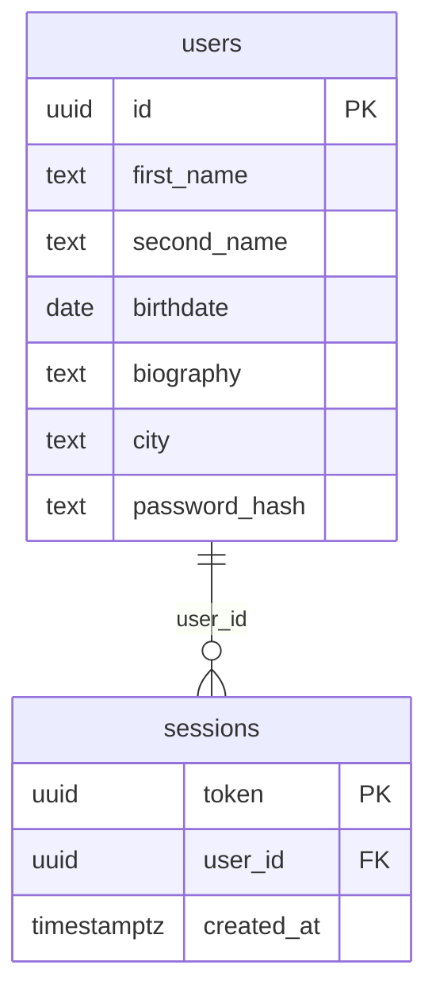

## Схема базы данных



`sessions.user_id` ссылается на `users.id`. У пользователя может не быть сессий или быть несколько.

## Допущения учебного проекта

- Токен авторизации — случайный UUID без срока действия. После успешного входа предыдущие токены этого пользователя удаляются, остаётся один действующий токен.
- Имя и фамилия не длиннее 100 символов, город не длиннее 100, биография не длиннее 2000. Пароль от 8 до 72 символов. Хеш bcrypt принимает не больше 72 байт, поэтому более длинная в байтах строка тоже отклоняется. Тело запроса не больше 64 КБ.

## Интеграционные тесты

Нужен запущенный Docker: тесты сами поднимают PostgreSQL через testcontainers и проверяют регистрацию, вход и чтение анкеты.

```bash
make test-integration
```

## Запуск в Docker

Нужен Docker. Команда собирает приложение и поднимает его вместе с PostgreSQL.

```bash
make docker-run
```

С хоста доступны:

- приложение — http://localhost:8080
- PostgreSQL — `localhost:5432`, пользователь `social`, пароль `social`, база `social`

Остановка:

```bash
make docker-stop
```

## Мониторинг (Grafana)

Вместе с приложением поднимаются Prometheus, node-exporter (метрики хоста), cAdvisor (метрики Docker-контейнеров) и Grafana с дашбордом [«Docker and system monitoring»](https://grafana.com/grafana/dashboards/893-main/) — системные метрики (CPU, память, диск, сеть) и метрики контейнеров на одном дашборде. Источник данных и дашборд настраиваются автоматически при запуске.

Открыть при запущенном Docker:

- Grafana — http://localhost:3000, логин `admin`, пароль `admin`. Дашборд — в списке Dashboards, называется «Docker and system monitoring».
- Prometheus — http://localhost:9090 (цели сбора метрик: Status → Targets).

Очистить накопленные метрики перед новым прогоном (пересоздаёт Prometheus с пустым хранилищем, в Grafana пропадёт старая история):

```bash
make metrics-reset
```

## Postman

Коллекция для приложения на http://localhost:8080: `docs/postman_collection.json`. Импортируйте её в Postman и выполняйте запросы по порядку.

- **Регистрация** — `POST /user/register`. Сохраняет `user_id` в переменную `userId`.
- **Вход** — `POST /login` с этим `userId` и паролем. Сохраняет `token`.
- **Анкета** — `GET /user/get/{{userId}}`.

Пароль по умолчанию — `Секретная строка`, его можно изменить в переменных коллекции. У запросов есть проверки ответа, папку можно прогнать через Collection Runner.

## E2E-тест

Нужен Docker. Тест останавливает уже запущенные контейнеры, заново собирает и поднимает приложение вместе с PostgreSQL и дожидается, пока API начнёт отвечать. Дальше проверяется один успешный сценарий.

```bash
make test-e2e
```

Проверяемые кейсы:

- `POST /user/register` с именем, фамилией, датой рождения, биографией, городом и паролем. Ожидается 200 и `user_id` в формате UUID.
- `POST /login` с этим `user_id` и тем же паролем. Ожидается 200 и `token` в формате UUID.
- `GET /user/get/{id}` с полученным `user_id`. Ожидается 200 и анкета с тем же идентификатором, именем, фамилией, датой рождения, биографией и городом. Пароля в ответе нет.

После теста контейнеры остаются запущенными.

## Нагрузочное тестирование

Консольный инструмент `cmd/loadgen` дёргает выбранную ручку уже запущенного приложения заданное число раз с заданным параллелизмом и печатает отчёт: число выполненных и успешных запросов, распределение HTTP-статусов, latency (минимум, максимум, среднее, медиана, p95, p99) и throughput.

Сборка:

```bash
go build -o bin/loadgen ./cmd/loadgen
```

Запуск (приложение должно быть запущено, например через `make docker-run`):

```bash
./bin/loadgen -endpoint search -requests 1000 -concurrency 100
```

Параметры:

- `-endpoint` — тестируемая ручка: `search` (`/user/search`, по умолчанию) или `get` (`/user/get/:id`, требует `-user-id`).
- `-base-url` — базовый URL приложения, по умолчанию `http://localhost:8080`.
- `-requests` — общее число запросов, по умолчанию 100.
- `-concurrency` — число одновременных запросов, по умолчанию 10.
- `-timeout` — таймаут одного запроса, по умолчанию 30s.
- `-first-name`, `-last-name` — префиксы имени и фамилии для поиска, по умолчанию `Роберт` и `Абрамов`.
- `-user-id` — идентификатор пользователя для `/user/get/:id`.

Примеры:

```bash
# поиск на 1, 10, 100 и 1000 одновременных запросов
./bin/loadgen -endpoint search -requests 1 -concurrency 1
./bin/loadgen -endpoint search -requests 1000 -concurrency 10
./bin/loadgen -endpoint search -requests 10000 -concurrency 100
./bin/loadgen -endpoint search -requests 100000 -concurrency 1000

# чтение анкеты
./bin/loadgen -endpoint get -user-id <uuid> -requests 1000 -concurrency 100
```

Остановка по Ctrl+C: инструмент дожидается завершения уже отправленных запросов и печатает отчёт по выполненным.
