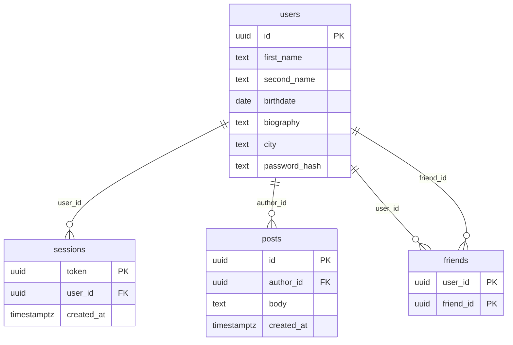
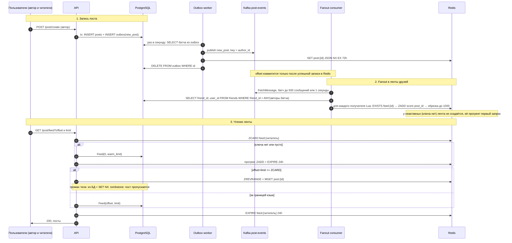

## Схема базы данных



`sessions.user_id` ссылается на `users.id`. У пользователя может не быть сессий или быть несколько.

`posts.author_id` ссылается на автора поста. `friends` хранит направленную связь: строка `(user_id, friend_id)` означает, что `user_id` добавил `friend_id` в друзья, но не наоборот.

## Допущения учебного проекта

- Токен авторизации — случайный UUID без срока действия. После успешного входа предыдущие токены этого пользователя удаляются, остаётся один действующий токен.
- Имя и фамилия не длиннее 100 символов, город не длиннее 100, биография не длиннее 2000. Пароль от 8 до 72 символов. Хеш bcrypt принимает не больше 72 байт, поэтому более длинная в байтах строка тоже отклоняется. Тело запроса не больше 64 КБ.
- Затравочные пользователи (`00003_users_data.sql`, датасет people.v2.csv) имеют общий пароль `9se3gwWE3Y9j4VU2`: его bcrypt-хеш стоит дефолтом колонки `password_hash` в `00001_init.sql`, а миграция `00009_seed_password.sql` переносит на него уже наполненные тома. Пользователи, зарегистрированные через API, получают bcrypt-хеш своего пароля.
- Ручки `/friend/*` и `/post/*` (кроме `/post/feed`) работают от имени текущего пользователя: нужен заголовок `Authorization: Bearer <token>` с токеном из `/login`. Без валидного токена — 401.
- `PUT /friend/set/{user_id}` и `PUT /friend/delete/{user_id}` идемпотентны: повторный вызов возвращает 200. Добавление несуществующего пользователя — 404, добавление самого себя — 400. Связь хранится направленной: `(user_id, friend_id)` означает, что первый добавил второго.
- Текст поста обрезается по краям, должен быть непустым и не длиннее 2000 символов. `POST /post/create` возвращает `{"id": "<uuid>"}`. Менять и удалять пост может только его автор (иначе 403), несуществующий пост — 404.
- `GET /post/feed` возвращает посты друзей из кэша Redis с fallback в PostgreSQL — механизм описан в разделе «Лента друзей».

## Допущения по ленте (учебный проект)

- Лента рассчитана на один инстанс приложения: нет распределённых блокировок, `SKIP LOCKED` в outbox и ребалансировки consumer'а между несколькими инстансами.
- `PUT /friend/delete/{user_id}` (unfriend) не чистит кэш: старые посты бывшего друга остаются в ленте до обрезки или истечения TTL. Новые посты перестают попадать, потому что fanout берёт друзей из текущей таблицы `friends`.
- Offset-пагинация по стыку кэша и БД может повторить или потерять пост при конкурентных изменениях ленты; для одного инстанса принято.
- Обработка outbox — at-most-once: строка удаляется и после успеха, и после ошибки. При недоступной Kafka публикация `new_post` теряется (fanout этого поста не будет), при недоступном Redis воркер повторяет запись бесконечно и встаёт на первом событии.
- Все записи в PostgreSQL и Redis из фоновых процессов повторяются бесконечно с backoff до успеха или остановки приложения.
- Kafka-дубликаты безопасны: `ZADD` того же `post_id` с тем же score не меняет ленту, а `SET NX` не перетирает существующее тело.

## Лента друзей: outbox, Kafka и кэш в Redis

Лента (`GET /post/feed`) — посты друзей, свежие сверху. Активный пользователь — тот, кто читал ленту за последние 24 часа: для него идентификаторы ленты хранятся в Redis, остальные читают из PostgreSQL.

### Путь поста: от создания до лент друзей



Правка и удаление идут той же схемой до шага 3: воркер обрабатывает `edit_post` (Lua-обновление `post:{id}`, если там не tombstone) и `delete_post` (tombstone `__deleted__` на 72ч), из ленты пост исчезает на чтении, когда чтение встречает tombstone.

### Ключи Redis

| Ключ | Тип | Содержимое | TTL |
|---|---|---|---|
| `feed:{user_id}` | ZSET | member = `post_id`, score = `created_at` в микросекундах | 24ч, продлевается на каждом чтении |
| `post:{id}` | STRING | JSON тела поста либо `__deleted__` для удалённых | 72ч |

`feed:{user_id}` хранит не более 1000 последних идентификаторов (`cache_limit`). Тела лежат отдельно: идентификаторы переживают eviction, тело поста достраивается из БД на чтении. Score — `created_at` в микросекундах: значение меньше 2^53, поэтому float64 хранит его без потери точности.

### Запись поста: transactional outbox

1. `POST /post/create` в одной транзакции PostgreSQL вставляет строку в `posts` и событие `new_post` в таблицу `outbox`. `PUT /post/update` и `PUT /post/delete/:id` пишут события `edit_post`/`delete_post` в той же транзакции, только если UPDATE/DELETE затронул строку.
2. Outbox-воркер раз в секунду (`outbox.poll_interval`) забирает батч до 100 событий и обрабатывает каждое:
   - `new_post` — публикует сообщение в Kafka (топик `post-events`, ключ `author_id`: посты одного автора попадают в одну партицию и сохраняют порядок) и кладёт тело поста в Redis через `SET post:{id} ... NX EX 72h` — сначала Kafka, потом кэш: потеря кэша восстановима из БД, потеря Kafka-сообщения — нет;
   - `edit_post` — Lua-скриптом обновляет `post:{id}`, только если там не tombstone;
   - `delete_post` — ставит `post:{id} = "__deleted__"` на 72ч.
3. Обработанная строка outbox удаляется. Повторы транзакций безопасны: `INSERT posts ... ON CONFLICT DO NOTHING`, события правки и удаления пишутся только при затронутых строках.

Kafka-продюсер настроен как idempotent (sarama: `Producer.Idempotent`, acks=`WaitForAll`): брокер не принимает дубли, транзитные ошибки ретраятся внутри продюсера.

### Fanout новых постов: Kafka consumer

Consumer group `feed-fanout` читает `post-events` батчами до 500 сообщений или 1 секунды (частичный батч по таймауту тоже обрабатывается):

1. Значения сообщений разбираются в посты; битые JSON логируются и пропускаются, чтобы не блокировать партицию.
2. Списки друзей всех авторов батча берутся одним SQL-запросом (`WHERE friend_id = ANY(...)` по индексу).
3. Посты группируются по получателям; для каждого лента обновляется Lua-скриптом атомарно: `ZADD` новых идентификаторов и обрезка до 1000 свежих. Запись выполняется только если ключ `feed:{user_id}` уже существует — неактивным пользователям лента не создаётся, её прогреет первый запрос.
4. Offset коммитится только после успешной записи в Redis; при ошибке Redis или коммита — бесконечный ретрай с backoff. Обработка at-least-once: после ребалансировки сообщения могут прийти повторно, дубль безопасен (см. допущения).

### Чтение ленты

`GET /post/feed?offset=&limit=`:

1. Если `feed:{user_id}` отсутствует — прогрев из БД (`warm_limit` последних постов друзей). Пустая лента ключ не создаёт: Redis не хранит пустые sorted set.
2. Если `offset+limit` целиком помещается в кэш (`ZCARD`) — идентификаторы берутся из `ZREVRANGE`, тела из `MGET post:{id}`. Промахи тела добираются из БД и кладутся обратно через `SET NX`; tombstone-посты пропускаются, посты, удалённые и из БД, тоже.
3. Иначе — запрос в PostgreSQL.
4. В обоих случаях TTL `feed:{user_id}` продлевается на 24ч: пользователь, читающий реже раза в сутки, считается неактивным, и его кэш истекает.

При недоступности Redis чтение деградирует в PostgreSQL (лог + ответ из БД); фоновые записи повторяются бесконечно. Флаг `feed.enabled: false` выключает кэш целиком — лента всегда читается из БД.

### Конфигурация

Все параметры — в `config/config.yaml` (секции `feed`, `redis`, `kafka`, `outbox`), каждая переопределяется переменной окружения (`FEED_*`, `REDIS_*`, `KAFKA_*`, `OUTBOX_*`). Docker-compose задаёт `REDIS_ADDR: redis:6379` и `KAFKA_BROKERS: kafka:9092`; для запуска приложения на хосте против docker-инфраструктуры дефолт — `localhost:6379` и `localhost:29092`.

Флаг `postgres.migrate_seed` управляет затравочными миграциями `*_data.sql` (пользователи, посты, друзья): полный запуск приложения наполняет таблицы, интеграционные тесты стартуют со схемой без данных.

### Метрики

`GET /metrics` отдаёт Prometheus-метрики приложения (цель `app:8080` в `deployments/prometheus/prometheus.yml`):

| Метрика | Что показывает |
|---|---|
| `feed_cache_hit_total` / `feed_cache_miss_total` | чтения ленты из кэша и из БД |
| `feed_warm_total`, `feed_warm_duration_seconds` | прогревы ленты и их длительность |
| `outbox_batch_size`, `outbox_lag` | размер батча воркера и число необработанных событий |
| `fanout_recipients_total`, `fanout_duration_seconds` | объём fanout и длительность обработки батча |

Логи: ошибки outbox-событий с `event_type` и `payload`, ошибки Redis с операцией и ключом, размер обработанного consumer'ом батча (debug).

## Интеграционные тесты

Нужен запущенный Docker: тесты сами поднимают PostgreSQL, Redis и Kafka через testcontainers и проверяют регистрацию, вход и чтение анкеты, а также полный путь кэша ленты (outbox → Kafka → fanout → Redis → чтение). Схема мигрируется без затравочных данных (`migrate_seed: false`) — тесты создают пользователей, постов и друзей сами через API, поэтому весь набор выполняется меньше минуты.

```bash
make test-integration
```

## Запуск в Docker

Нужен Docker. Команда собирает приложение и поднимает его вместе с PostgreSQL, Redis и Kafka.

```bash
make docker-run
```

С хоста доступны:

- приложение — http://localhost:8080, метрики — http://localhost:8080/metrics
- PostgreSQL через HAProxy: `localhost:5000` — запись (лидер), `localhost:5001` — чтение (реплики); пользователь `social`, пароль `social`, база `social`
- узлы PostgreSQL напрямую (для отладки): `localhost:5433`–`5435` (`patroni1`–`patroni3`)
- Redis — `localhost:6379`
- Kafka — `localhost:29092` (host-listener; внутри compose-сети брокер — `kafka:9092`)

Остановка:

```bash
make docker-stop
```

Полный перезапуск с нуля (удалить контейнеры, тома и образ приложения, пересобрать, поднять кластер и обновить дашборд Grafana):

```bash
make docker-fresh
```

## Мониторинг (Grafana)

Вместе с приложением поднимаются Prometheus, node-exporter (метрики хоста), cAdvisor (метрики контейнеров), postgres-exporter на каждый узел Patroni (метрики БД) и Grafana с дашбордом «Postgres cluster»: CPU узлов `patroni1`–`patroni3` и кумулятивное число закоммиченных транзакций по узлам (`pg_stat_database_xact_commit`). Метрики Patroni (роль узла, лаг реплик) тоже собираются в Prometheus. Приложение отдаёт свои метрики кэша ленты, outbox-воркера и fanout-консьюмера на `/metrics` (цель `app:8080` в `deployments/prometheus/prometheus.yml`). Источник данных и дашборд настраиваются автоматически при запуске.

cAdvisor видит контейнеры по Docker ID, поэтому после пересоздания pg-контейнеров (`make docker-reset`, пересборка) дашборд нужно обновить:

```bash
make update-dashboard
```

Открыть при запущенном Docker:

- Grafana — http://localhost:3000, логин `admin`, пароль `admin`. Дашборд — в списке Dashboards, называется «Docker and system monitoring».
- Prometheus — http://localhost:9090 (цели сбора метрик: Status → Targets).

Очистить накопленные метрики перед новым прогоном (пересоздаёт Prometheus с пустым хранилищем, в Grafana пропадёт старая история):

```bash
make metrics-reset
```

## Кластер PostgreSQL (Patroni)

Кластер под управлением Patroni: три узла `patroni1`–`patroni3` (образ `build/patroni.Dockerfile`, конфиг `deployments/patroni/patroni.yml`), состояние кластера — в `etcd`. Лидер и реплики выбираются Patroni автоматически. При первом старте `deployments/patroni/post_bootstrap.sh` создаёт роль и базу приложения, а схему и тестовые данные накатывает приложение через goose-миграции. Репликация кворумная синхронная (`synchronous_mode: quorum`, `synchronous_standby_names = ANY 1 (...)`): коммит ждёт подтверждения от одной из двух реплик. Управляется через REST API Patroni: `curl -X PATCH http://localhost:8008/config -H 'Content-Type: application/json' -d '{"synchronous_mode": "quorum"}'` (`false` — выключить).

Перед кластером стоит HAProxy (`deployments/haproxy/haproxy.cfg`), роль узлов определяется по REST API Patroni:

- `haproxy:5000` (с хоста `localhost:5000`) — запись, ведёт на лидера;
- `haproxy:5001` (с хоста `localhost:5001`) — чтение, round-robin по репликам;
- `localhost:8404` — статистика HAProxy.

Приложение ходит только через HAProxy: write-пул на порт 5000, read-пул (поиск анкет) на 5001. Прямые порты узлов для отладки: `localhost:5433`–`5435` (пользователь `social`, пароль `social`, база `social`).

Состав и состояние кластера (кто лидер, кто реплика, лаг):

```bash
docker exec highloadarchitect-patroni1 gosu postgres patronictl -c /etc/patroni/patroni.yml list
```

То же самое через REST API Patroni с хоста — `/cluster` отдаёт состав всего кластера и доступен с любого живого узла, `/patroni` — подробное состояние конкретного узла:

- patroni1 — http://localhost:8008/cluster
- patroni2 — http://localhost:8009/cluster
- patroni3 — http://localhost:8010/cluster

```bash
curl -s http://localhost:8009/cluster | python3 -m json.tool   # состав кластера
curl -s http://localhost:8009/patroni  | python3 -m json.tool   # состояние узла patroni2
```

Полный цикл поднятия с нуля — `make docker-fresh` (реплики клонируют лидер, занимает пару минут; приложение стартует, когда реплики встанут в строй).

## Postman

Коллекция для приложения на http://localhost:8080: `docs/postman_collection.json`. Импортируйте её в Postman и выполняйте запросы по порядку.

- **Регистрация** — `POST /user/register`. Сохраняет `user_id` в переменную `userId`.
- **Вход** — `POST /login` с этим `userId` и паролем. Сохраняет `token`.
- **Анкета** — `GET /user/get/{{userId}}`.

Пароль по умолчанию — `Секретная строка`, его можно изменить в переменных коллекции. У запросов есть проверки ответа, папку можно прогнать через Collection Runner.

## E2E-тест

Нужен Docker. Тест останавливает уже запущенные контейнеры, заново собирает и поднимает приложение вместе с PostgreSQL и дожидается, пока API начнёт отвечать. Дальше проверяется один успешный сценарий.

```bash
make test-e2e
```

Проверяемые кейсы:

- `POST /user/register` с именем, фамилией, датой рождения, биографией, городом и паролем. Ожидается 200 и `user_id` в формате UUID.
- `POST /login` с этим `user_id` и тем же паролем. Ожидается 200 и `token` в формате UUID.
- `GET /user/get/{id}` с полученным `user_id`. Ожидается 200 и анкета с тем же идентификатором, именем, фамилией, датой рождения, биографией и городом. Пароля в ответе нет.

После теста контейнеры остаются запущенными.

## Нагрузочное тестирование

Консольный инструмент `cmd/loadgen` дёргает выбранную ручку уже запущенного приложения заданное число раз с заданным параллелизмом и печатает отчёт: число выполненных и успешных запросов, распределение HTTP-статусов, latency (минимум, максимум, среднее, медиана, p95, p99) и throughput.

Сборка:

```bash
go build -o bin/loadgen ./cmd/loadgen
```

Запуск (приложение должно быть запущено, например через `make docker-run`):

```bash
./bin/loadgen -mode read -requests 1000 -concurrency 100
```

Параметры:

- `-mode` — режим нагрузки: `read` (поиск анкет `GET /user/search`, по умолчанию) или `write` (регистрация пользователей `POST /user/register`, каждый запрос создаёт уникального пользователя).
- `-base-url` — базовый URL приложения, по умолчанию `http://localhost:8080`.
- `-requests` — общее число запросов, по умолчанию 100.
- `-concurrency` — число одновременных запросов, по умолчанию 10.
- `-timeout` — таймаут одного запроса, по умолчанию 30s.
- `-first-name`, `-last-name` — префиксы имени и фамилии для режима `read`, по умолчанию `Роберт` и `Абрамов`.

Примеры:

```bash
# чтение на 1, 10, 100 и 1000 одновременных запросов
./bin/loadgen -mode read -requests 1 -concurrency 1
./bin/loadgen -mode read -requests 1000 -concurrency 10
./bin/loadgen -mode read -requests 10000 -concurrency 100
./bin/loadgen -mode read -requests 100000 -concurrency 1000

# запись
./bin/loadgen -mode write -requests 1000 -concurrency 10
```

Остановка по Ctrl+C: инструмент дожидается завершения уже отправленных запросов и печатает отчёт по выполненным.
