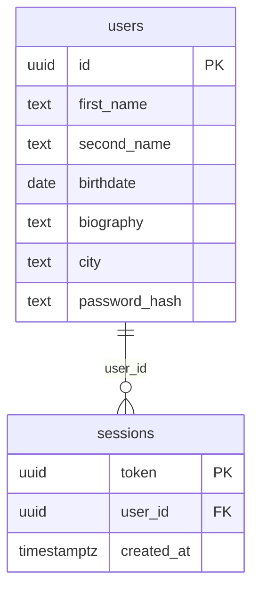

## Схема базы данных



`sessions.user_id` ссылается на `users.id`. У пользователя может не быть сессий или быть несколько.

## Допущения учебного проекта

- Токен авторизации — случайный UUID без срока действия. После успешного входа предыдущие токены этого пользователя удаляются, остаётся один действующий токен.
- Имя и фамилия не длиннее 100 символов, город не длиннее 100, биография не длиннее 2000. Пароль от 8 до 72 символов. Хеш bcrypt принимает не больше 72 байт, поэтому более длинная в байтах строка тоже отклоняется. Тело запроса не больше 64 КБ.

## Интеграционные тесты

Нужен запущенный Docker: тесты сами поднимают PostgreSQL через testcontainers и проверяют регистрацию, вход и чтение анкеты.

```bash
make test-integration
```

## Запуск в Docker

Нужен Docker. Команда собирает приложение и поднимает его вместе с PostgreSQL.

```bash
make docker-run
```

С хоста доступны:

- приложение — http://localhost:8080
- PostgreSQL — `localhost:5432`, пользователь `social`, пароль `social`, база `social`

Остановка:

```bash
make docker-stop
```

Полный перезапуск с нуля (удалить контейнеры, тома и образ приложения, пересобрать, поднять кластер и обновить дашборд Grafana):

```bash
make docker-fresh
```

## Мониторинг (Grafana)

Вместе с приложением поднимаются Prometheus, node-exporter (метрики хоста), cAdvisor (метрики контейнеров), postgres-exporter на каждый узел Patroni (метрики БД) и Grafana с дашбордом «Postgres cluster»: CPU узлов `patroni1`–`patroni3` и кумулятивное число закоммиченных транзакций по узлам (`pg_stat_database_xact_commit`). Метрики Patroni (роль узла, лаг реплик) тоже собираются в Prometheus. Источник данных и дашборд настраиваются автоматически при запуске.

cAdvisor видит контейнеры по Docker ID, поэтому после пересоздания pg-контейнеров (`make docker-reset`, пересборка) дашборд нужно обновить:

```bash
make update-dashboard
```

Открыть при запущенном Docker:

- Grafana — http://localhost:3000, логин `admin`, пароль `admin`. Дашборд — в списке Dashboards, называется «Docker and system monitoring».
- Prometheus — http://localhost:9090 (цели сбора метрик: Status → Targets).

Очистить накопленные метрики перед новым прогоном (пересоздаёт Prometheus с пустым хранилищем, в Grafana пропадёт старая история):

```bash
make metrics-reset
```

## Кластер PostgreSQL (Patroni)

Кластер под управлением Patroni: три узла `patroni1`–`patroni3` (образ `build/patroni.Dockerfile`, конфиг `deployments/patroni/patroni.yml`), состояние кластера — в `etcd`. Лидер и реплики выбираются Patroni автоматически, при первом старте лидер накатывает схему и наполнение через `deployments/patroni/post_bootstrap.sh`.

Перед кластером стоит HAProxy (`deployments/haproxy/haproxy.cfg`), роль узлов определяется по REST API Patroni:

- `haproxy:5000` (с хоста `localhost:5000`) — запись, ведёт на лидера;
- `haproxy:5001` (с хоста `localhost:5001`) — чтение, round-robin по репликам;
- `localhost:8404` — статистика HAProxy.

Приложение ходит только через HAProxy: write-пул на порт 5000, read-пул (поиск анкет) на 5001. Прямые порты узлов для отладки: `localhost:5433`–`5435` (пользователь `social`, пароль `social`, база `social`).

Состояние кластера:

```bash
docker exec highloadarchitect-patroni1 gosu postgres patronictl -c /etc/patroni/patroni.yml list
```

Полный цикл поднятия с нуля — `make docker-fresh` (реплики клонируют лидер, занимает пару минут; приложение стартует, когда реплики встанут в строй).

## Postman

Коллекция для приложения на http://localhost:8080: `docs/postman_collection.json`. Импортируйте её в Postman и выполняйте запросы по порядку.

- **Регистрация** — `POST /user/register`. Сохраняет `user_id` в переменную `userId`.
- **Вход** — `POST /login` с этим `userId` и паролем. Сохраняет `token`.
- **Анкета** — `GET /user/get/{{userId}}`.

Пароль по умолчанию — `Секретная строка`, его можно изменить в переменных коллекции. У запросов есть проверки ответа, папку можно прогнать через Collection Runner.

## E2E-тест

Нужен Docker. Тест останавливает уже запущенные контейнеры, заново собирает и поднимает приложение вместе с PostgreSQL и дожидается, пока API начнёт отвечать. Дальше проверяется один успешный сценарий.

```bash
make test-e2e
```

Проверяемые кейсы:

- `POST /user/register` с именем, фамилией, датой рождения, биографией, городом и паролем. Ожидается 200 и `user_id` в формате UUID.
- `POST /login` с этим `user_id` и тем же паролем. Ожидается 200 и `token` в формате UUID.
- `GET /user/get/{id}` с полученным `user_id`. Ожидается 200 и анкета с тем же идентификатором, именем, фамилией, датой рождения, биографией и городом. Пароля в ответе нет.

После теста контейнеры остаются запущенными.

## Нагрузочное тестирование

Консольный инструмент `cmd/loadgen` дёргает выбранную ручку уже запущенного приложения заданное число раз с заданным параллелизмом и печатает отчёт: число выполненных и успешных запросов, распределение HTTP-статусов, latency (минимум, максимум, среднее, медиана, p95, p99) и throughput.

Сборка:

```bash
go build -o bin/loadgen ./cmd/loadgen
```

Запуск (приложение должно быть запущено, например через `make docker-run`):

```bash
./bin/loadgen -mode read -requests 1000 -concurrency 100
```

Параметры:

- `-mode` — режим нагрузки: `read` (поиск анкет `GET /user/search`, по умолчанию) или `write` (регистрация пользователей `POST /user/register`, каждый запрос создаёт уникального пользователя).
- `-base-url` — базовый URL приложения, по умолчанию `http://localhost:8080`.
- `-requests` — общее число запросов, по умолчанию 100.
- `-concurrency` — число одновременных запросов, по умолчанию 10.
- `-timeout` — таймаут одного запроса, по умолчанию 30s.
- `-first-name`, `-last-name` — префиксы имени и фамилии для режима `read`, по умолчанию `Роберт` и `Абрамов`.

Примеры:

```bash
# чтение на 1, 10, 100 и 1000 одновременных запросов
./bin/loadgen -mode read -requests 1 -concurrency 1
./bin/loadgen -mode read -requests 1000 -concurrency 10
./bin/loadgen -mode read -requests 10000 -concurrency 100
./bin/loadgen -mode read -requests 100000 -concurrency 1000

# запись
./bin/loadgen -mode write -requests 1000 -concurrency 10
```

Остановка по Ctrl+C: инструмент дожидается завершения уже отправленных запросов и печатает отчёт по выполненным.
