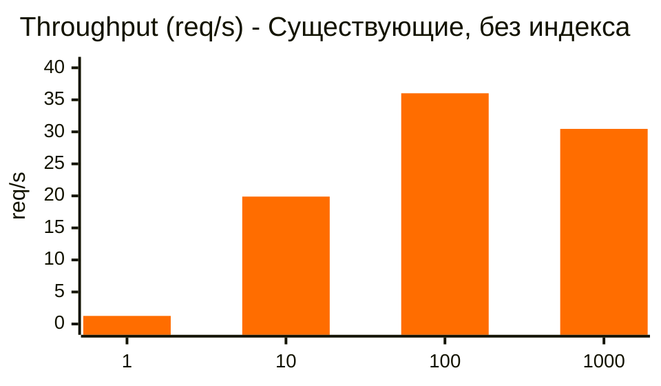
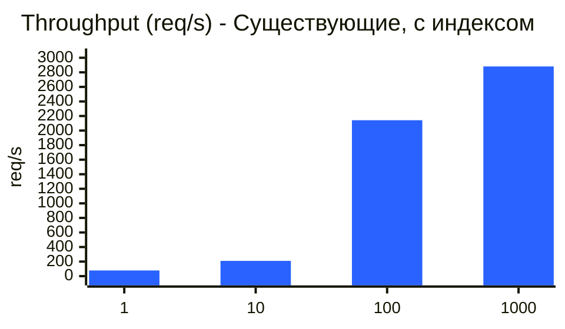
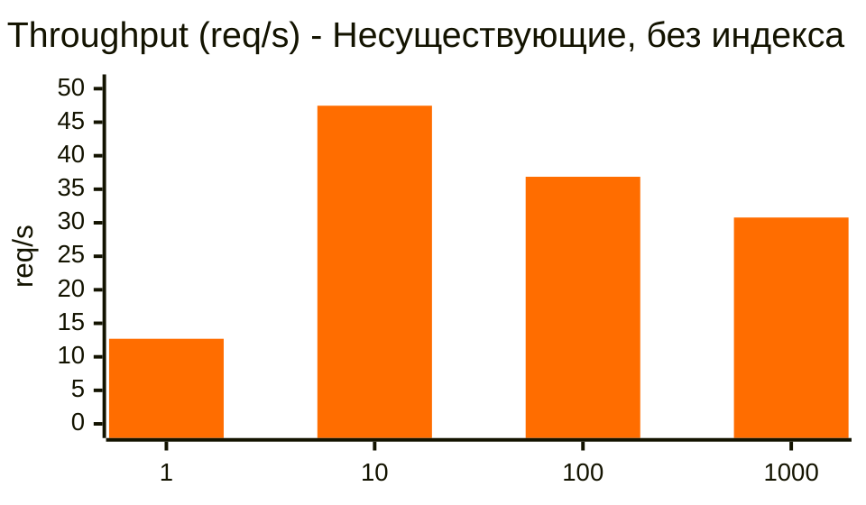

# Запросы для explain

Запрос с высокой селективностью (длинные префиксы, мало совпадений):
```sql
SELECT id, first_name, second_name, birthdate, biography, city
FROM users
WHERE first_name LIKE 'Влад%'
  AND second_name LIKE 'Мельн%'
ORDER BY id;
```

Запрос с низкой селективностью (короткие префиксы, много совпадений):
```sql
SELECT id, first_name, second_name, birthdate, biography, city
FROM users
WHERE first_name LIKE 'В%'
  AND second_name LIKE 'М%'
ORDER BY id;
```

# Запросы для замеров

Запрос существующих пользователей:
```sql
SELECT id, first_name, second_name, birthdate, biography, city
FROM users
WHERE first_name LIKE 'Роберт%'
  AND second_name LIKE 'Абрамов%'
ORDER BY id;
```

Запрос несуществующих пользователей:
```sql
SELECT id, first_name, second_name, birthdate, biography, city
FROM users
WHERE first_name LIKE 'Nomatch%'
  AND second_name LIKE 'Missing%'
ORDER BY id;
```

# Замер throughput

Для каждого сценария одновременно запускается N запросов: 1, 10, 100 или 1000. Отдельно проверяются сценарии с существующими и несуществующими пользователями. Запросы сначала дожидаются готовности и стартуют по общему сигналу
Успешным считается запрос, который вернул HTTP 200 и прошёл проверку ответа: для существующих пользователей в списке есть анкеты с нужным префиксом, для несуществующих список пустой. Если хотя бы один запрос завершился ошибкой, прогон не включается в отчёт. Поэтому в таблицах количество успешно завершённых запросов N совпадает с уровнем параллелизма

Throughput рассчитывается по всему прогону: **Throughput = N успешно завершённых запросов / T**

Здесь T — время от общего сигнала старта до завершения последнего запроса

<div style="page-break-after: always;"></div>

# Без индекса

Вывод explain analyze:

```
Sort  (cost=27409.67..27409.68 rows=1 width=68) (actual time=178.004..185.350 rows=73.00 loops=1)
  Sort Key: id
  Sort Method: quicksort  Memory: 31kB
  Buffers: shared hit=15920 read=4240
  ->  Gather  (cost=1000.00..27409.66 rows=1 width=68) (actual time=111.946..185.252 rows=73.00 loops=1)
        Workers Planned: 2
        Workers Launched: 2
        Buffers: shared hit=15920 read=4240
        ->  Parallel Seq Scan on users  (cost=0.00..26409.56 rows=1 width=68) (actual time=102.022..167.614 rows=24.33 loops=3)
              Filter: ((first_name ~~ 'Влад%'::text) AND (second_name ~~ 'Мельн%'::text))
              Rows Removed by Filter: 333286
              Buffers: shared hit=15920 read=4240
Planning:
  Buffers: shared hit=6 dirtied=1
Planning Time: 0.417 ms
Execution Time: 185.426 ms
```

```
Gather Merge  (cost=27635.53..28697.59 rows=9119 width=68) (actual time=196.608..205.048 rows=9413.00 loops=1)
  Workers Planned: 2
  Workers Launched: 2
  Buffers: shared hit=15891 read=4343
  ->  Sort  (cost=26635.51..26645.01 rows=3800 width=68) (actual time=170.106..170.376 rows=3137.67 loops=3)
        Sort Key: id
        Sort Method: quicksort  Memory: 604kB
        Buffers: shared hit=15891 read=4343
        Worker 0:  Sort Method: quicksort  Memory: 316kB
        Worker 1:  Sort Method: quicksort  Memory: 319kB
        ->  Parallel Seq Scan on users  (cost=0.00..26409.56 rows=3800 width=68) (actual time=107.773..167.719 rows=3137.67 loops=3)
              Filter: ((first_name ~~ 'В%'::text) AND (second_name ~~ 'М%'::text))
              Rows Removed by Filter: 330172
              Buffers: shared hit=15819 read=4341
Planning Time: 1.968 ms
Execution Time: 205.896 ms
```

Видим `Seq Scan`, а значит запрос выполняет полное сканирование таблицы (на параллельных воркерах чтобы хоть как то ускорить обработку)

### Результаты замеров без индекса:

| Тест | latency медиана (мс) | throughput (req/s) |
|---|---:|---:|
| 1 существующие | 793.739 | 1.26 |
| 1 несуществующие | 78.738 | 12.69 |
| 10 существующие | 441.383 | 19.89 |
| 10 несуществующие | 193.381 | 47.46 |
| 100 существующие | 1522.451 | 36.02 |
| 100 несуществующие | 1492.080 | 36.86 |
| 1000 существующие | 16834.656 | 30.46 |
| 1000 несуществующие | 16858.652 | 30.78 |

<div style="page-break-after: always;"></div>

# С индексом

### Выбор индекса

Требования:
- запрос вида `firstName LIKE ? and secondName LIKE ?`
- поиск анкет по префиксу имени и фамилии (одновременно)
- нужен поиск по диапазонам значений, фактически диапазонам строк, начинающихся с заданного префикса.

У нас только префиксный поиск, а значит GIN-индекс не требуется. Для работы с диапазонами значений подходит BTREE, а для корректного сравнения строк требуется дополнительно использовать `text_pattern_ops`, который позволяет принудительно выполнять побайтовое сравнение строк. Без этого, сравнение строк выполнялось бы с особенностями конкретного языка, что не всегда подходит для префиксного поиска. Т.к в запросе поиск выполняется по 2 полям, то я использую составной индекс с последовательностью полей именно такой, как в запросе.

Нюансы использования GIN-индекса:
- позволяет оптимизировать запросы вида '%some_text%', т.е не только поиск по префиксу
- нужна установка расширения pg_trgm
- индекс получается существенно больше. Для тестового набора данным BTREE индекс занимает 1мб, а для GIN - 28мб
- сложность поддержания - добавление/обновление дороже, есть особенности взаимодействия с VACUUM и механизмом отложенного обслуживания индекса

Итоговый запрос для создания индекса:
```sql
CREATE INDEX IF NOT EXISTS idx_users_search
    ON users (
    first_name text_pattern_ops,
    second_name text_pattern_ops
    );
```

Вывод explain analyze:

```
Sort  (cost=12.90..12.91 rows=1 width=68) (actual time=0.548..0.553 rows=73.00 loops=1)
  Sort Key: id
  Sort Method: quicksort  Memory: 31kB
  Buffers: shared hit=57 read=10
  ->  Index Scan using idx_users_search on users  (cost=0.42..12.89 rows=1 width=68) (actual time=0.181..0.459 rows=73.00 loops=1)
        Index Cond: ((first_name ~>=~ 'Влад'::text) AND (first_name ~<~ 'Влае'::text) AND (second_name ~>=~ 'Мельн'::text) AND (second_name ~<~ 'Мельо'::text))
        Filter: ((first_name ~~ 'Влад%'::text) AND (second_name ~~ 'Мельн%'::text))
        Index Searches: 7
        Buffers: shared hit=57 read=10
Planning:
  Buffers: shared hit=19 read=1
Planning Time: 1.228 ms
Execution Time: 0.659 ms
```

```
Sort  (cost=17037.74..17060.54 rows=9119 width=68) (actual time=23.104..23.995 rows=9413.00 loops=1)
  Sort Key: id
  Sort Method: quicksort  Memory: 1238kB
  Buffers: shared hit=1644 read=93
  ->  Bitmap Heap Scan on users  (cost=207.96..16437.95 rows=9119 width=68) (actual time=5.320..17.846 rows=9413.00 loops=1)
        Filter: ((first_name ~~ 'В%'::text) AND (second_name ~~ 'М%'::text))
        Heap Blocks: exact=1626
        Buffers: shared hit=1644 read=93
        ->  Bitmap Index Scan on idx_users_search  (cost=0.00..205.68 rows=8998 width=0) (actual time=5.007..5.007 rows=9413.00 loops=1)
              Index Cond: ((first_name ~>=~ 'В'::text) AND (first_name ~<~ 'Г'::text) AND (second_name ~>=~ 'М'::text) AND (second_name ~<~ 'Н'::text))
              Index Searches: 27
              Buffers: shared hit=50 read=61
Planning:
  Buffers: shared hit=19 read=1
Planning Time: 2.425 ms
Execution Time: 24.840 ms
```

Видим `Bitmap Index Scan`, значит индекс успешно применен для запроса, но т.к результатов достаточно много то строки таблицы запрашиваются не напрямую, а используя битовую карту, что позволяет учитывать локальность данных и оптимизировать чтение. Кроме того сортировка по id не использует первичный индекс, т.к данные берутся из индекса `idx_users_search`, а там они упорядочен по first_name и second_name 

### Результаты замеров с индексом:

| Тест | latency медиана (мс) | throughput (req/s) |
|---|---:|---:|
| 1 существующие | 12.007 | 77.99 |
| 1 несуществующие | 4.857 | 204.88 |
| 10 существующие | 28.723 | 209.73 |
| 10 несуществующие | 3.602 | 470.50 |
| 100 существующие | 39.784 | 2141.99 |
| 100 несуществующие | 9.888 | 4586.58 |
| 1000 существующие | 227.066 | 2880.58 |
| 1000 несуществующие | 95.319 | 6200.10 |

<div style="page-break-after: always;"></div>

# Сравнение результатов

Для Latency на одном графике можно увидеть разницу. Синий - с индексом

```mermaid
%%{init: {"xyChart": {"width": 480, "height": 280, "showLegend": true}, "themeVariables": {"xyChart": {"plotColorPalette": "#ff6d00, #2962ff"}}}}%%
xychart-beta
    title "Latency (мс) - Существующие"
    x-axis ["1", "10", "100", "1000"]
    y-axis "мс" 0 --> 18000
    bar "без индекса" [793.739, 441.383, 1522.451, 16834.656]
    bar "с индексом" [12.007, 28.723, 39.784, 227.066]
```

```mermaid
%%{init: {"xyChart": {"width": 480, "height": 280, "showLegend": true}, "themeVariables": {"xyChart": {"plotColorPalette": "#ff6d00, #2962ff"}}}}%%
xychart-beta
    title "Latency (мс) -  Несуществующие"
    x-axis ["1", "10", "100", "1000"]
    y-axis "мс" 0 --> 18000
    bar "без индекса" [78.738, 193.381, 1492.080, 16858.652]
    bar "с индексом" [4.857, 3.602, 9.888, 95.319]
```





<div style="page-break-after: always;"></div>

Для Throughput разница слишком значительна, поэтому графики до/после индекса разделены








| Тест | Latency, медиана | Throughput |
|---|---:|---:|
| 1 существующие | −98.5% | +6089.7% |
| 1 несуществующие | −93.8% | +1514.5% |
| 10 существующие | −93.5% | +954.4% |
| 10 несуществующие | −98.1% | +891.4% |
| 100 существующие | −97.4% | +5846.7% |
| 100 несуществующие | −99.3% | +12343.2% |
| 1000 существующие | −98.7% | +9356.9% |
| 1000 несуществующие | −99.4% | +20043.3% |