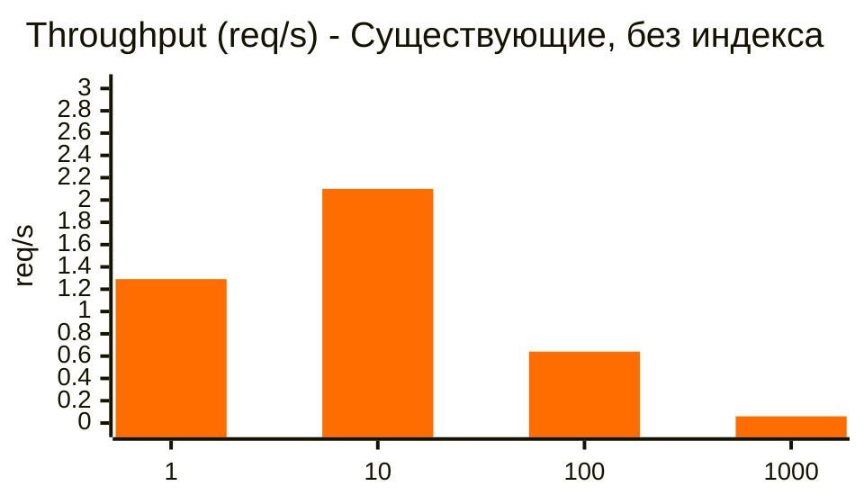
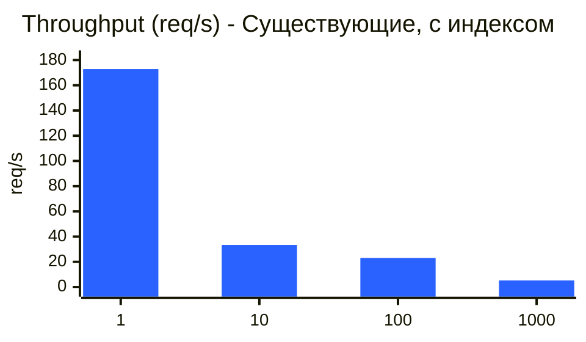
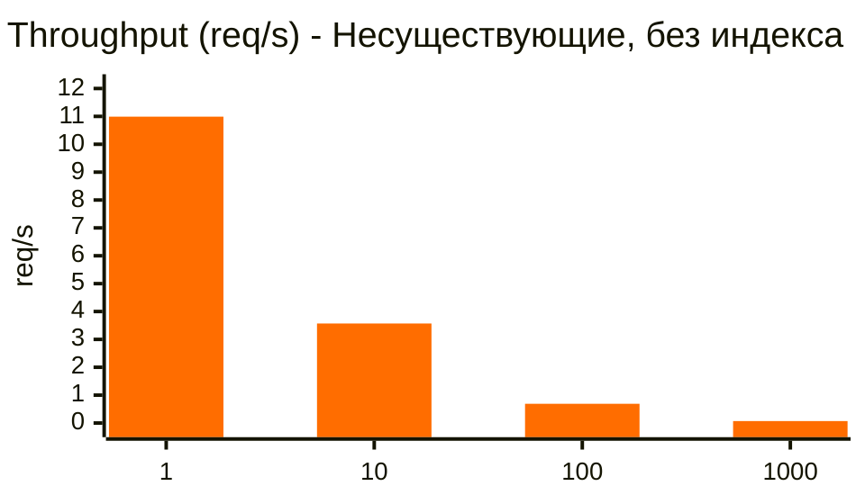
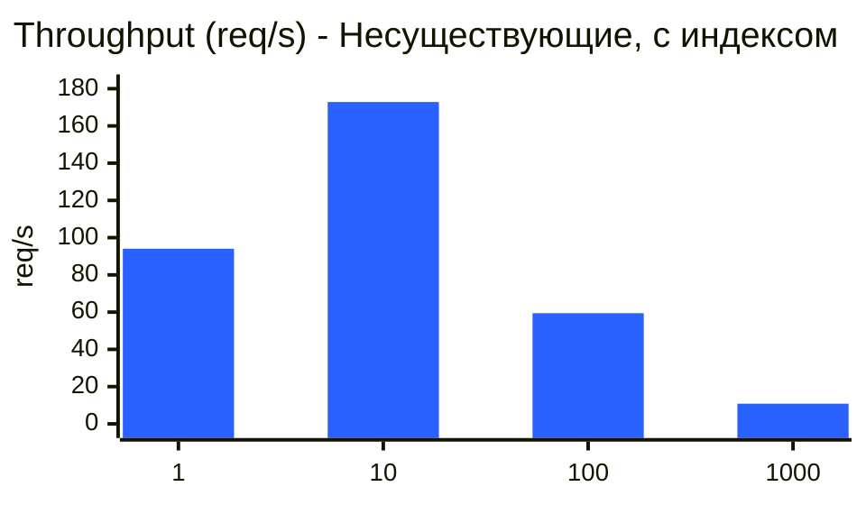

# Без индекса

Explain:
```
Gather  (cost=1000.00..27409.66 rows=1 width=68) (actual time=96.665..139.372 rows=27.00 loops=1)
  Workers Planned: 2
  Workers Launched: 2
  Buffers: shared hit=1032 read=19128
  ->  Parallel Seq Scan on users  (cost=0.00..26409.56 rows=1 width=68) (actual time=73.701..106.542 rows=9.00 loops=3)
        Filter: ((first_name ~~ 'Владислав%'::text) AND (second_name ~~ 'Мельников%'::text))
        Rows Removed by Filter: 333301
        Buffers: shared hit=1032 read=19128
Planning:
  Buffers: shared hit=6
Planning Time: 0.745 ms
Execution Time: 139.492 ms
```

Видим `Seq Scan`, а значит запрос выполняет полное сканирование таблицы

### Результаты замеров без индекса:

| Тест | latency медиана (мс) | throughput медиана (req/s) |
|---|---:|---:|
| 1 существующие | 777.009 | 1.29 |
| 1 несуществующие | 91.007 | 10.99 |
| 10 существующие | 476.395 | 2.10 |
| 10 несуществующие | 279.910 | 3.57 |
| 100 существующие | 1570.032 | 0.64 |
| 100 несуществующие | 1448.021 | 0.69 |
| 1000 существующие | 15441.977 | 0.06 |
| 1000 несуществующие | 15167.750 | 0.07 |

<div style="page-break-after: always;"></div>

# С индексом

### Выбор индекса

Требования:
- запрос вида `firstName LIKE ? and secondName LIKE ?`
- поиск анкет по префиксу имени и фамилии (одновременно)

Это позволяет использовать BTREE (префиксный поиск из коробки) и исключить GIN, который бы понадобился в случае запросов вида `%text%`. В моем случае дополнительно требуется использовать `text_pattern_ops`, который позволяет принудительно выполнять побайтовое сравнение строк. Без этого, сравнение строк выполнялось бы с особенностями конкретного языка, что не всегда подходит для префиксного поиска. Т.к в запросе поиск выполняется по 2 полям, то я использую составной индекс с последовательностью полей именно такой, как в запросе

Нюансы использования GIN-индекса для полнотекстового поиска:
- позволяет оптимизировать запросы вида '%some_text%', т.е не только поиск по префиксу
- нужна установка расширения pg_trgm
- индекс получается существенно больше. Для тестового набора данным BTREE индекс занимает 1мб, а для GIN - 28мб
- сложность поддержания - добавление/обновление дороже, есть особенности взаимодействия с VACUUM и механизмом отложенного обслуживания индекса

Итоговый запрос для создания индекса:
```sql
CREATE INDEX IF NOT EXISTS idx_users_search
    ON users (
    first_name text_pattern_ops,
    second_name text_pattern_ops
    );
```

Explain:
```
Index Scan using idx_users_search on users  (cost=0.42..8.46 rows=1 width=68) (actual time=0.672..0.960 rows=27.00 loops=1)
  Index Cond: ((first_name ~>=~ 'Владислав'::text) AND (first_name ~<~ 'Владислаг'::text) AND (second_name ~>=~ 'Мельников'::text) AND (second_name ~<~ 'Мельниког'::text))
  Filter: ((first_name ~~ 'Владислав%'::text) AND (second_name ~~ 'Мельников%'::text))
  Index Searches: 4
  Buffers: shared hit=22 read=9
Planning:
  Buffers: shared hit=27 read=8 dirtied=1
Planning Time: 4.611 ms
Execution Time: 1.035 ms
```

Видим `Index Scan`, значит индекс успешно применен для запроса

### Результаты замеров с индексом:

| Тест | latency медиана (мс) | throughput медиана (req/s) |
|---|---:|---:|
| 1 существующие | 5.785 | 172.87 |
| 1 несуществующие | 10.633 | 94.04 |
| 10 существующие | 29.930 | 33.41 |
| 10 несуществующие | 5.790 | 172.84 |
| 100 существующие | 43.298 | 23.10 |
| 100 несуществующие | 16.830 | 59.42 |
| 1000 существующие | 192.087 | 5.21 |
| 1000 несуществующие | 92.367 | 10.83 |

<div style="page-break-after: always;"></div>

# Сравнение результатов

Для Latency на одном графике можно увидеть разницу

```mermaid
%%{init: {"xyChart": {"width": 480, "height": 280}, "themeVariables": {"xyChart": {"plotColorPalette": "#ff6d00, #2962ff"}}}}%%
xychart-beta
    title "Latency (мс) - Существующие"
    x-axis ["1", "10", "100", "1000"]
    y-axis "мс" 0 --> 16000
    bar [777.009, 476.395, 1570.032, 15441.977]
    bar [5.785, 29.930, 43.298, 192.087]
```




<div style="page-break-after: always;"></div>

Для Throughput разница слишком значительна, поэтому графики до/после индекса разделены









| Тест | Latency, медиана | Throughput, медиана |
|---|---:|---:|
| 1 существующие | −99.3% | +13300.8% |
| 1 несуществующие | −88.3% | +755.7% |
| 10 существующие | −93.7% | +1491.0% |
| 10 несуществующие | −97.9% | +4741.5% |
| 100 существующие | −97.2% | +3509.4% |
| 100 несуществующие | −98.8% | +8511.6% |
| 1000 существующие | −98.8% | +8583.3% |
| 1000 несуществующие | −99.4% | +15371.4% |