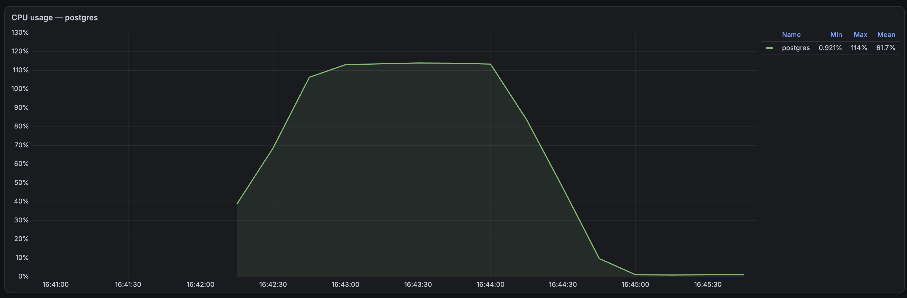
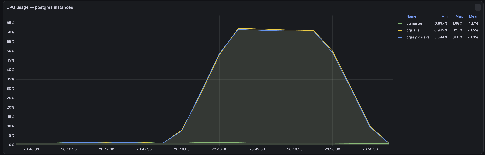
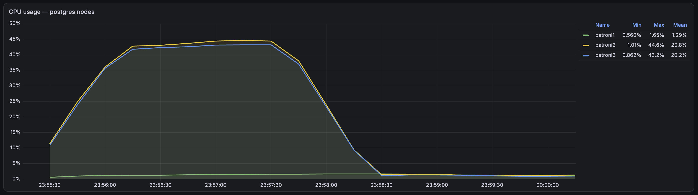
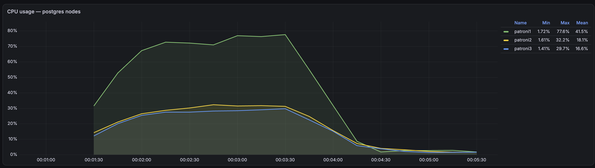
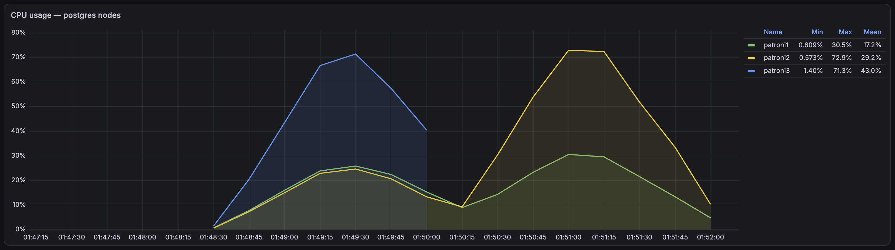
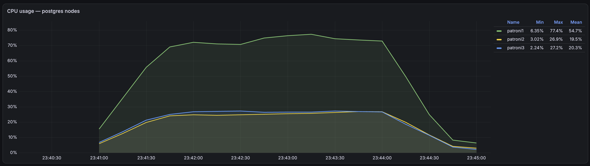
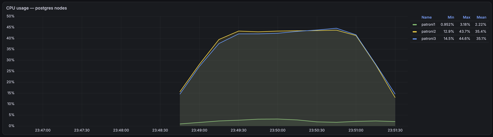
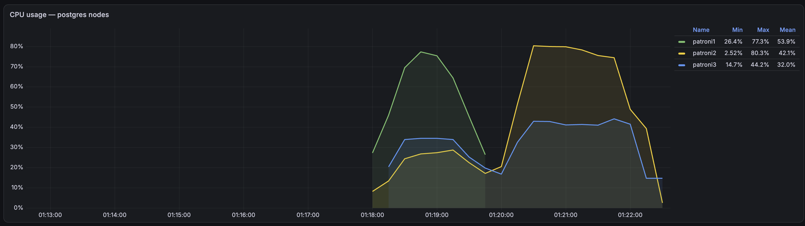

## Методика

- **READ-тест**: 500 000 запросов `GET /user/search` в 100 параллельных потоков.
- **WRITE-тест**: 250 000 запросов `POST /user/register` в 100 параллельных потоков. Ручка выполняет 1 INSERT и 1 SELECT в БД.
- Нагрузка подаётся утилитой `cmd/loadgen` с хоста на приложение, развёрнутое в docker-compose.
- Метрики инфраструктуры снимаются с дашборда Grafana (CPU узлов PostgreSQL, коммиты транзакций).

---

## Эксперимент 1. Один узел PostgreSQL

**Конфигурация**

- 1 узел PostgreSQL.
- Приложение использует один общий пул соединений на единственный узел.

**Скриншоты**

*READ-тест: дашборд Grafana во время прогона — CPU узла PostgreSQL и число закоммиченных транзакций.*

---

## Эксперимент 2. Кластер из 3 узлов: мастер + 2 реплики, асинхронная потоковая репликация

**Конфигурация**

- 3 узла PostgreSQL с отдельной конфигурацией для каждого в docker-compose; реплики подняты через `pg_basebackup -R` (master, slave, async-slave).
- Приложение использует 2 пула соединений — для чтения и для записи. Пулы инициализируются списком адресов узлов; узлы для чтения перебираются по Round Robin внутри приложения.

**Скриншоты**

*READ-тест: дашборд Grafana — CPU трёх узлов кластера (мастер и две реплики) во время прогона. Чтение идёт только на реплики, мастер почти не нагружен.*

---

## Эксперимент 3. Patroni-кластер, асинхронная репликация, роутинг через HAProxy

**Конфигурация**

- 3 узла PostgreSQL под управлением Patroni (асинхронная репликация). Docker-образ каждой ноды включает локальные настройки Patroni.
- etcd — хранилище динамической конфигурации Patroni (роли узлов).
- HAProxy с двумя frontend: `pg_write` (мастер) и `pg_read` (реплики). Принадлежность backend-узлов определяется через Patroni REST API (leader/replica health-check).
- Приложение использует 2 пула соединений, в каждом один адрес — соответствующий frontend HAProxy.
- Для исключения влияния кода на потери транзакций добавлены бесконечные ретраи вставок (на временные ошибки): пока идут выборы лидера, приложение повторяет INSERT.

Состав кластера на момент теста:

| Узел | Роль | Состояние | Lag |
|---|---|---|---|
| patroni1 | leader | running | — |
| patroni2 | replica | streaming | 0 |
| patroni3 | replica | streaming | 0 |

**Результаты**

На момент старта теста с остановкой мастера лидером был patroni3; после его остановки лидером стал patroni2, нагрузка чтения перераспределилась на patroni1. Потерь транзакций не зафиксировано — при асинхронной репликации это скорее везение (лаг реплик на localhost близок к нулю, окно потерь минимально).

**Скриншоты**

*READ-тест: дашборд Grafana — CPU узлов Patroni-кластера и коммиты транзакций. Чтение распределяется по репликам через HAProxy.*

*WRITE-тест: дашборд Grafana — нагрузка на лидера (все записи идут через frontend pg_write), реплики принимают только WAL.*

*WRITE-тест с остановкой мастера: в середине прогона лидер patroni3 остановлен, лидером стал patroni2 — виден провал нагрузки на старом лидере и её рост на новом.*

---

## Эксперимент 4. Patroni-кластер, кворумная синхронная репликация, роутинг через HAProxy

**Конфигурация**

- Аналогично эксперименту 3, но включена кворумная синхронная репликация (`synchronous_mode: quorum`, коммит ждёт подтверждения от любой одной реплики).

Состав кластера на момент теста:

| Узел | Роль | Состояние | Lag |
|---|---|---|---|
| patroni1 | leader | running | — |
| patroni2 | quorum_standby | streaming | 0 |
| patroni3 | quorum_standby | streaming | 0 |

**Результаты**

На момент старта теста с остановкой мастера лидером был patroni1; после его остановки лидером стал patroni2, нагрузка чтения перераспределилась на patroni3. Потерь транзакций нет — при синхронной репликации это гарантируется протоколом (коммит подтверждается только после flush WAL на кворумной реплике).

**Скриншоты**

*WRITE-тест с синхронной репликацией: дашборд Grafana — CPU лидера и quorum-реплик. Коммит ждёт flush WAL на реплике, поэтому нагрузка заметна на всех узлах.*

*READ-тест с синхронной репликацией: дашборд Grafana — чтение по-прежнему идёт только на реплики, лидер нагружен лишь фоновой репликацией.*

*WRITE-тест с остановкой мастера: в середине прогона лидер patroni1 остановлен, лидером стал patroni2 — на графике виден момент переключения и перераспределение нагрузки.*

---

## Сравнение производительности

### READ (500 000 запросов /user/search, 100 потоков)

| Конфигурация | throughput, req/s | latency медиана, мс |
|---|---|---|
| 1 узел PostgreSQL | 4141.88 | 24.17 |
| Мастер + 2 реплики (async, роутинг в приложении) | 4288.97 | 20.81 |
| Patroni + HAProxy (async) | 3660.45 | 25.55 |
| Patroni + HAProxy (sync quorum) | 3493.55 | 26.33 |

### WRITE, стабильный кластер (250 000 запросов /user/register, 100 потоков)

| Конфигурация | throughput, req/s | latency медиана, мс |
|---|---|---|
| Patroni + HAProxy (async) | 1847.66 | 49.87 |
| Patroni + HAProxy (sync quorum) | 1300.40 | 67.83 |

### WRITE с остановкой мастера в процессе теста

| Конфигурация | throughput, req/s | latency медиана, мс | Потери транзакций |
|---|---|---|---|
| Patroni + HAProxy (async) | 1520.57 | 46.20 | не зафиксированы |
| Patroni + HAProxy (sync quorum) | 1053.30 | 73.16 | нет |

### Выводы

- **READ**: переход с одного узла на 3-узловой кластер с Round Robin по репликам дал небольшой прирост (~4%); добавление HAProxy и включение синхронной репликации постепенно снижают throughput чтения (~−16% к одиночному узлу) за счёт дополнительного сетевого hop и фоновой репликации.
- **WRITE**: синхронная репликация ожидаемо дороже асинхронной — throughput падает на ~30% (коммит ждёт flush WAL на реплике), медианная latency растёт с ~50 до ~68 мс.
- **Остановка мастера** под нагрузкой снижает throughput ещё на ~18% (async) и ~19% (sync): время выборов нового лидера (~несколько секунд) приложение пережидает на ретраях — отдельные запросы ждали до 36–38 с, хотя медиана почти не изменилась. Ошибок и неподтверждённых потерь в обоих режимах не зафиксировано, но гарантию отсутствия потерь даёт только синхронный режим.
